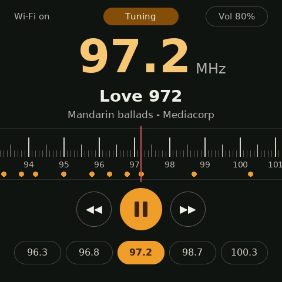

# SG FM Radio for ESP-Mosaico



An FM-radio style player for Singapore's local stations. Sweep the dial,
seek, or tap a station chip to tune in. ESP-Mosaico has no FM tuner chip, so
each station plays from its official live internet stream over Wi-Fi
(17 stations, 88.3 to 100.3 MHz; see `components/app_stations`).

Wi-Fi: set your network once in Vibe Mode (Settings > Wi-Fi) and the radio
uses it. Or, for development, put a fallback in an untracked
`sdkconfig.local.defaults`:

```
CONFIG_APP_WIFI_SSID="your-network"
CONFIG_APP_WIFI_PASSWORD="your-password"
```

The last station and volume are remembered across reboots.

Created with `python mosaico.py project init`.
The same GSP 1.5.1 scene and portable C UI run on PC and ESP-Mosaico.

From the workspace root:

```sh
python mosaico.py project sim --project projects/sg_fm_radio --interactive
python mosaico.py recover
python mosaico.py iris system-update --project projects/sg_fm_radio
```

Run `recover` before the first install on a blank or unverified device.
Use `system-update` for new apps or changed resources/layouts. Use `app-update`
only for code changes with an identical full partition table and resources.

Application components:

- `components/app_radio_ui`: portable radio screen controller and tuning logic.
- `components/app_radio_ui/host`: simulator adapter (fake player) and its separate
  CMake build, reusing the same controller; excluded from the ESP32 build.
- `components/app_radio_ui/ui/main.json`: authored scene; `dial_strip.png` is
  generated by `tools/gen_dial_strip.py`.
- `components/app_stations`: station table and lookups (portable).
- `components/app_radio_player`: device stream player (HTTP MP3 -> speaker).
- `components/app_wifi`: Wi-Fi station using Vibe Mode's saved network.
- `components/app_display`: BSP-to-GSP display and optional touch policy.
- `main`: device startup and dependency composition only.

`project sim` discovers a unique scene under `components/*/ui/main.json` (or the
older root `ui/main.json`). With multiple scenes, select one using `--scene PATH`,
relative to the project. This previews only that scene; omit `--scene` to run the
PC backend and its compiled application behavior.

Dependency direction: `main -> app_radio_ui -> {ESP-GSP, app_stations}`,
`main -> app_radio_player -> {app_stations, BSP, esp_audio_simple_player}`,
`main -> app_wifi` and `main -> app_display -> BSP/ESP-GSP`. No application
component depends on `main`; only `main` connects the UI to the player. Public headers live in `include/`; private state stays
in implementation files. Each component README includes its contract and usage.

When adding behavior, keep `main` as a composition root. Add cohesive `app_*`
components only for independent responsibilities, declare public/private CMake
dependencies explicitly, and keep the graph acyclic. Avoid cross-module globals;
pass handles, context and value snapshots. Keep each public API comment within
three lines, describing its purpose and key preconditions/results. Put detailed
ownership, lifecycle, threading and timeout contracts in the component README;
document units and ranges beside fields.
Third-party dependencies retain upstream names. Pins and workspace overrides live
in `main/idf_component.yml` and the root CMake configuration. Apply local patches
in a dedicated dependency checkout and select it with `override_path`; never edit
`managed_components/` in place.

Git, editor and hook entry files stay at the root; format rules, project policy
and setup instructions live in `tools/quality/`. See its README to enable hooks.
The `tools/quality/policy.json` prefix rule checks local application component names.
Architecture and API semantics also require code review; formatter/static-analysis
success alone does not establish those contracts.
